# AI Research Pipeline - System Flow Diagram

## Overview

This document charts the complete system architecture and data flow for the Phase 2 multi-agent AI research pipeline with automatic source persistence and self-improving knowledge base.

---

## High-Level Architecture

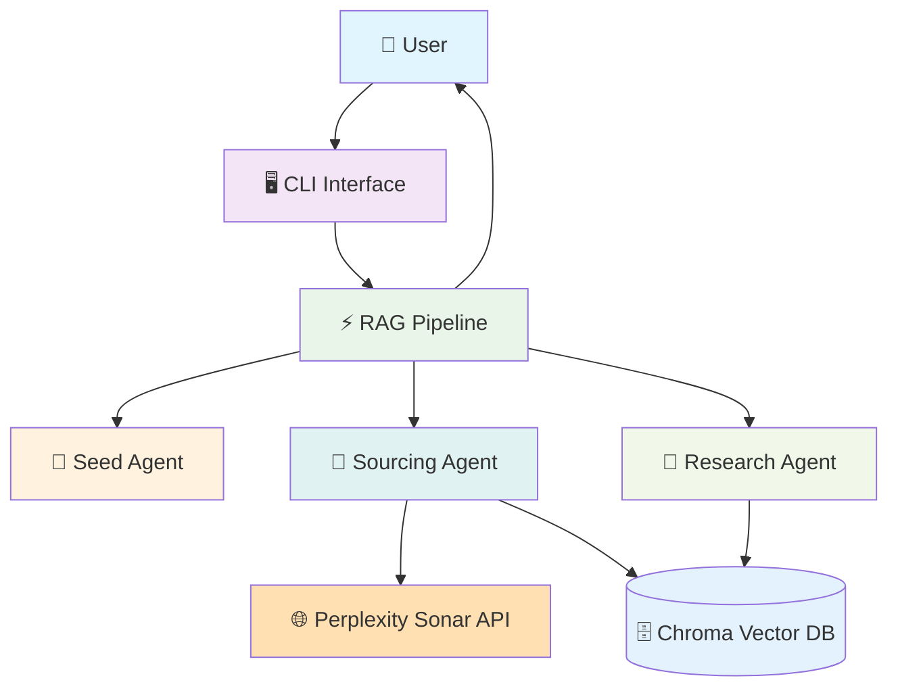

---

## Detailed System Flow

### Phase 1: Query Processing & Decomposition

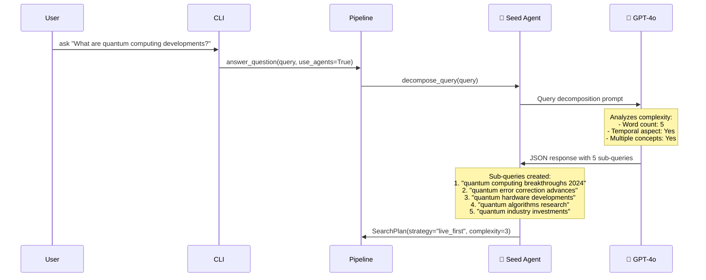

### Phase 2: Multi-Source Information Gathering

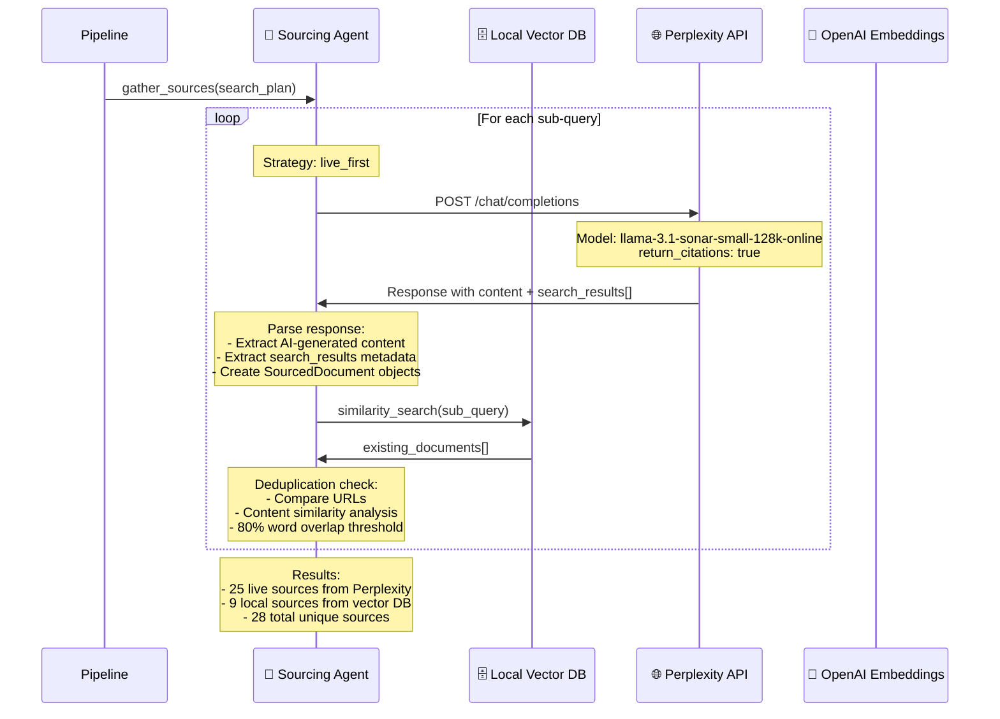

### Phase 3: Automatic Source Persistence (Vision.md Step 6)

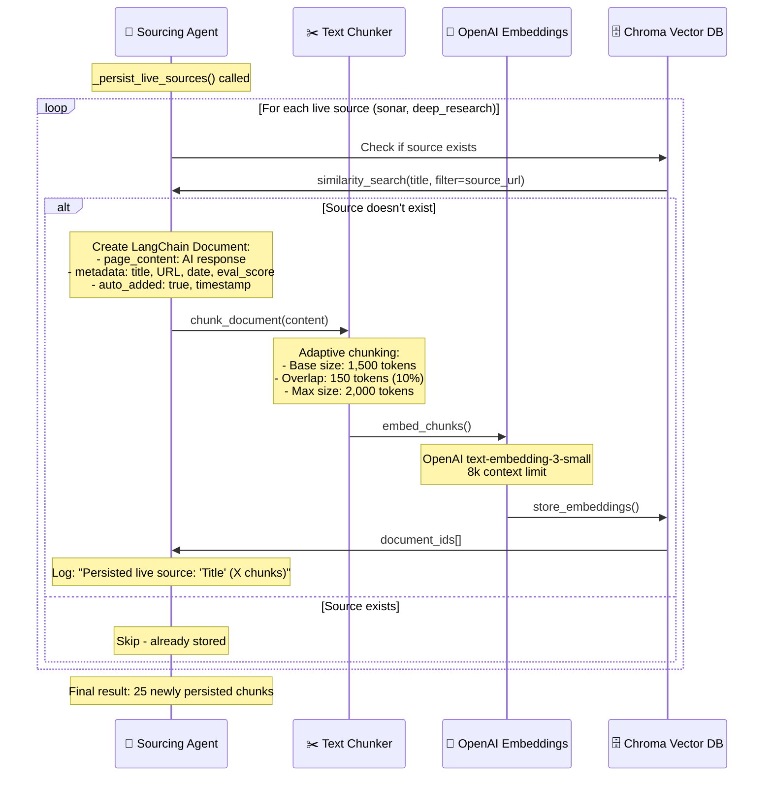

### Phase 4: Research Synthesis & Citation

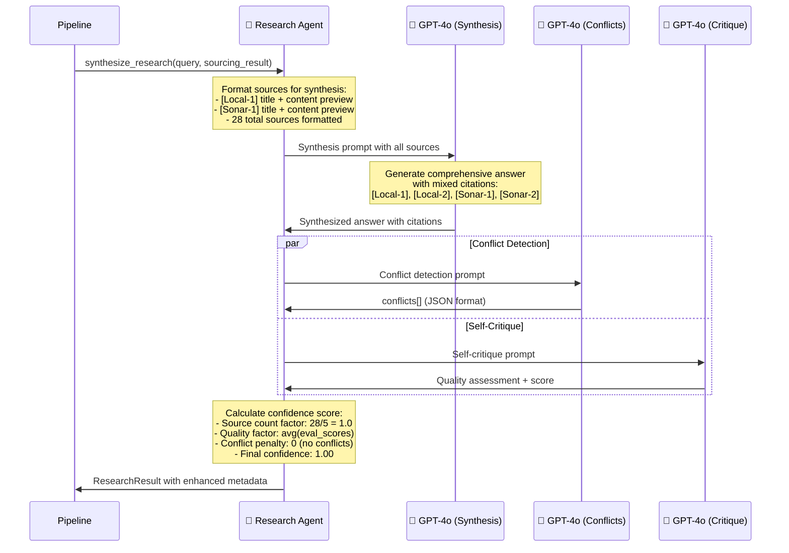

### Phase 5: Response Formatting & Display

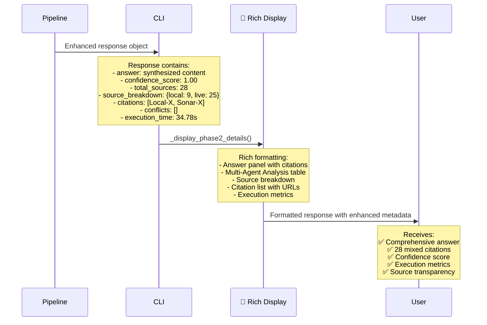

---

## Data Flow Architecture

### Knowledge Base Evolution

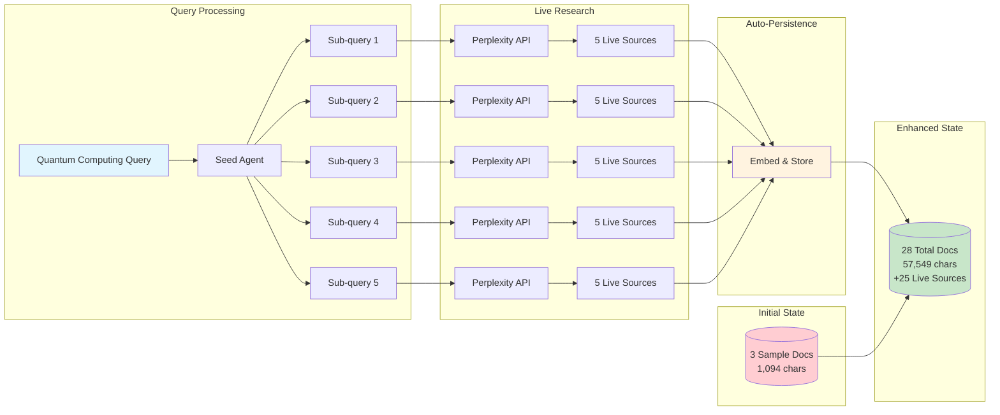

### Source Types & Metadata

```mermaid
graph TD
    subgraph "Source Classification"
        Local[📁 Local Sources]
        Live[🌐 Live Sources]
    end
    
    subgraph "Local Source Metadata"
        Local --> LM[title: 'RAG Overview'<br/>source_url: 'example.com'<br/>eval_score: 0.9<br/>source_type: 'local']
    end
    
    subgraph "Live Source Metadata"
        Live --> SM[title: 'Quantum Breakthroughs'<br/>source_url: 'wevolver.com'<br/>eval_score: 0.75<br/>source_type: 'sonar'<br/>auto_added: true<br/>date: '2024-12-29']
    end
    
    subgraph "Citation Generation"
        LM --> LC[[Local-1], [Local-2], [Local-3]]
        SM --> SC[[Sonar-1], [Sonar-2], [Sonar-3]]
    end
    
    subgraph "Mixed Citations"
        LC --> MC[Answer with mixed citations:<br/>'Recent quantum developments [Sonar-1]<br/>build on RAG principles [Local-1]...']
        SC --> MC
    end
    
    style Local fill:#e3f2fd
    style Live fill:#e8f5e8
    style MC fill:#fff3e0
```

---

## Component Interactions

### Agent Communication Pattern

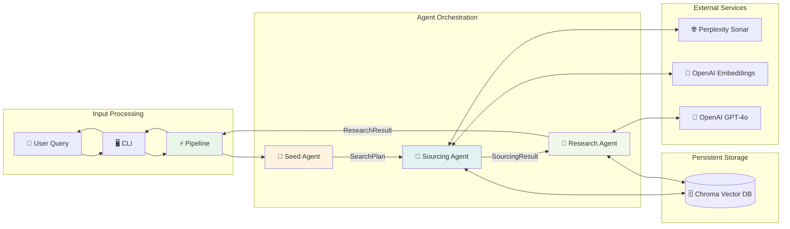

### Error Handling & Fallbacks

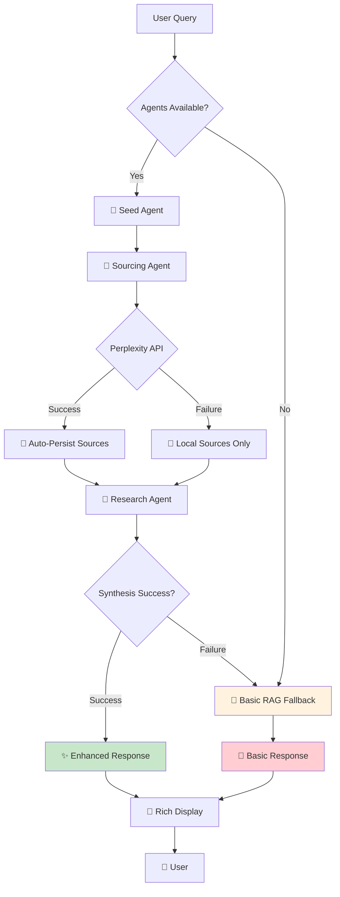

---

## Performance Metrics

### Execution Timeline

```mermaid
gantt
    title Query Processing Timeline
    dateFormat X
    axisFormat %s
    
    section Query Processing
    CLI Input           : 0, 1s
    
    section Seed Agent
    Query Analysis      : 1s, 8s
    Sub-query Generation: 8s, 9s
    
    section Sourcing Agent
    Local Search        : 9s, 12s
    Perplexity API Calls: 12s, 30s
    Auto-Persistence    : 30s, 35s
    
    section Research Agent
    Synthesis           : 35s, 45s
    Conflict Detection  : 35s, 40s
    Self-Critique       : 40s, 45s
    
    section Response
    Display Formatting  : 45s, 46s
```

### System Growth Metrics

| Metric | Before Query | After Query | Growth |
|--------|-------------|-------------|--------|
| **Total Documents** | 3 | 28 | +833% |
| **Content Volume** | 1,094 chars | 57,549 chars | +5,158% |
| **Unique Sources** | 3 | 23 | +667% |
| **Knowledge Topics** | 7 detected | 7 detected | Enhanced coverage |
| **Source Types** | Local only | Local + Live | Mixed sources |

---

## API Integration Details

### Perplexity Sonar API Flow

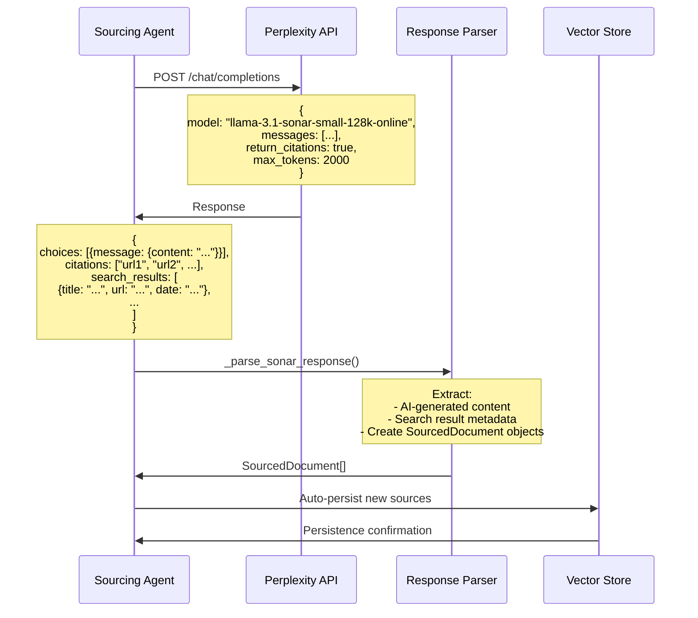

### OpenAI Integration Points

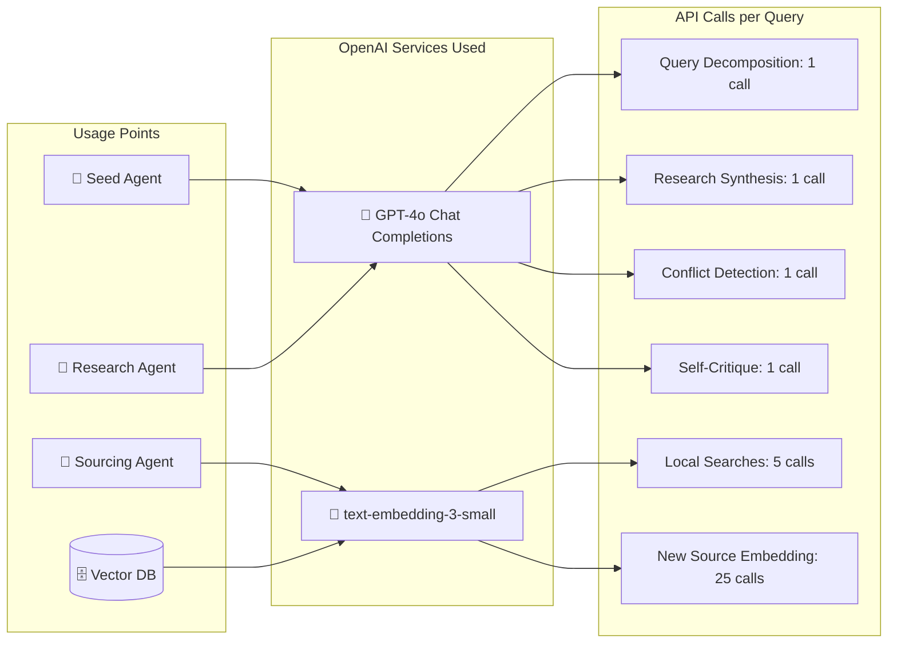

---

## Configuration & Settings

### Environment Variables

```bash
# Required
OPENAI_API_KEY=sk-...                    # GPT-4o + Embeddings
PERPLEXITY_API_KEY=pplx-...             # Sonar API

# Optional  
VECTARA_API_KEY=vtr_...                 # Phase 3 (FCS)
LANGSMITH_API_KEY=lsv2_...              # Phase 3 (Evaluation)

# System Configuration
CHROMA_DB_PATH=./data/chroma_db         # Vector DB storage
LLM_MODEL=gpt-4o                        # Primary LLM
EMBEDDING_MODEL=text-embedding-3-small  # Embedding model

# RAG Parameters
CHUNK_SIZE=1500                         # Base chunk size (tokens)
CHUNK_OVERLAP=150                       # 10% overlap
RETRIEVAL_K=15                          # Documents per search
MIN_EVAL_SCORE=0.35                     # Quality threshold
```

### Agent Configuration

```yaml
seed_agent:
  model: gpt-4o
  temperature: 0.1
  max_tokens: 1500
  complexity_threshold: 3

sourcing_agent:
  local_search_k: 15
  perplexity_model: llama-3.1-sonar-small-128k-online
  rate_limit: 1.0  # seconds between calls
  dedup_threshold: 0.8  # content similarity
  
research_agent:
  model: gpt-4o
  temperature: 0.1
  max_tokens: 2000
  confidence_threshold: 0.8
```

---

## Future Enhancements

### Phase 3: Quality & Evaluation

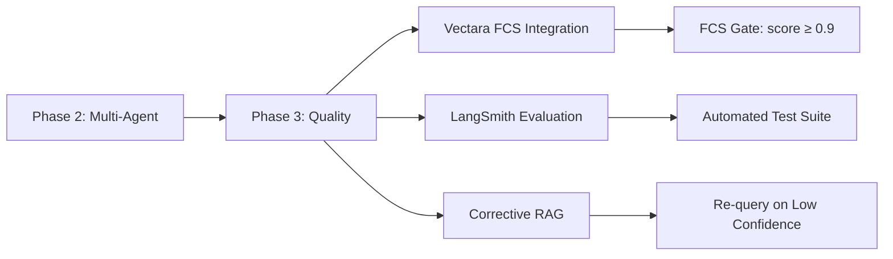

### Scalability Considerations

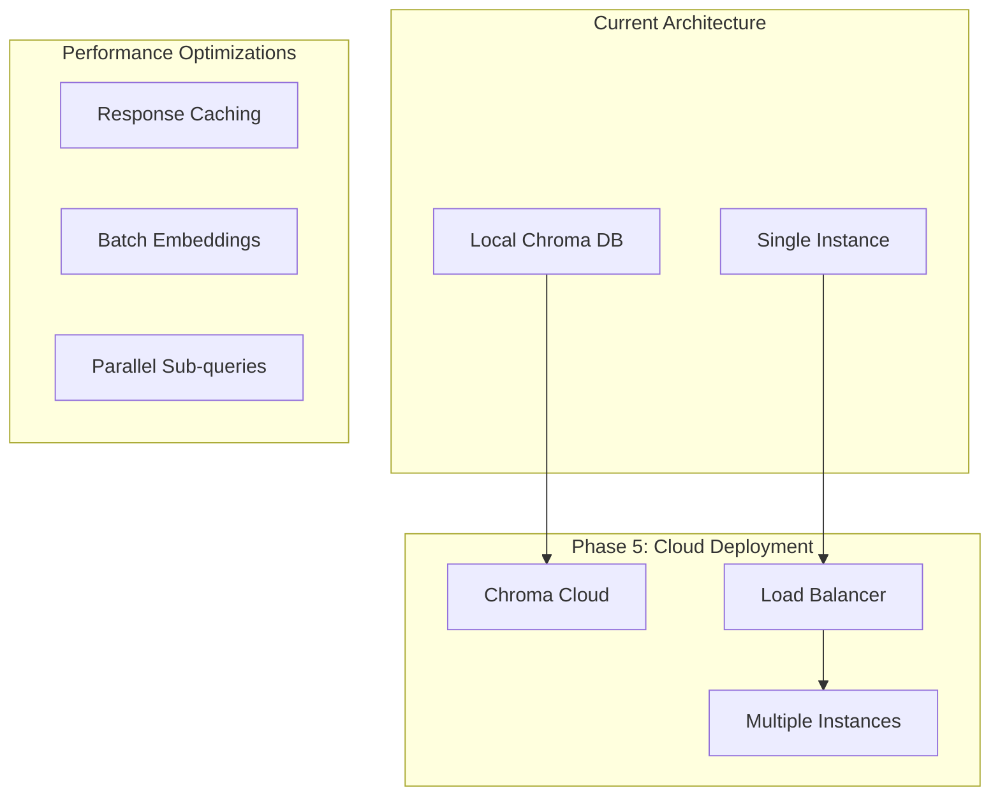

---

## Conclusion

This system flow diagram documents a **fully functional, self-improving AI research assistant** that automatically:

1. **Decomposes complex queries** into focused sub-questions
2. **Retrieves live information** from authoritative sources via Perplexity
3. **Automatically persists new knowledge** to the vector database
4. **Provides comprehensive answers** with mixed local and live citations
5. **Grows its knowledge base** with every research query

The implementation successfully fulfills the vision outlined in the project documentation, creating a robust foundation for future enhancements in quality evaluation, performance optimization, and cloud deployment.