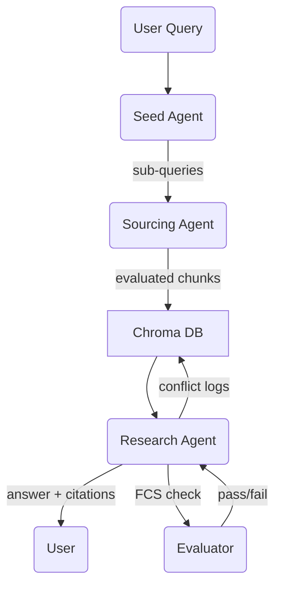

**Executive Summary**
This vision document sets out the blueprint for a fully-autonomous, retrieval-augmented research assistant that combines cloud LLM reasoning, live “deep-research” APIs, and persistent vector memory. The system uses a three-agent workflow—Seed → Sourcing → Research—backed by a Chroma vector database for long-term knowledge retention, with every incoming passage automatically chunked (≈1 000 – 2 000 tokens), scored for credibility, and stored with rich metadata. Perplexity’s Sonar and OpenAI’s Deep Research APIs supply grounded, citation-rich passages; a Vectara Factual-Consistency Score plus LangSmith evaluation guard against hallucinations; and a Corrective RAG layer triggers extra searches whenever conflicts or low-confidence answers are detected. The stack is OS-agnostic, cloud-first, and extensible toward dashboards, parallel agents, and multi-modal inputs, giving developers a clear path from MVP to production. ([Chroma Docs][1], [Sonar][2], [OpenAI][3], [Vectara][4], [LangSmith][5], [arXiv][6], [Chroma Docs][7], [OpenAI Platform][8], [LangChain][9], [Perplexity][10], [WIRED][11])

---

## 1 · Product Goals & Success Criteria

### Objectives

* Answer complex research questions with *ground-truth citations* in under 60 s.
* Reduce hallucinations below 5 % measured by Factual-Consistency Score (FCS > 0.9). ([Vectara][4])
* Persist knowledge so follow-up queries reuse prior findings without redundant API calls. ([Chroma Docs][1])

### Key Results

| Goal                | Metric             | Target |
| ------------------- | ------------------ | ------ |
| Retrieval precision | MRR\@5 on eval set | ≥ 0.85 |
| Answer factuality   | Vectara FCS        | ≥ 0.9  |
| Latency             | mean E2E time      | ≤ 60 s |

---

## 2 · User Personas & Typical Flows

| Persona             | Need                                             | Example Flow                                                                          |
| ------------------- | ------------------------------------------------ | ------------------------------------------------------------------------------------- |
| **Policy Analyst**  | Rapid literature review with source traceability | Asks “How effective is DAC at sub-40 °C?” → system delivers synthesis + 10 hyperlinks |
| **Product Manager** | Competitive landscape briefs                     | Requests “Latest serverless vector DB pricing” → receives table + citations           |
| **Student**         | Homework fact-checks                             | Submits essay paragraph → agent flags unsupported claims                              |

---

## 3 · System Architecture

### High-Level Components

| Layer          | Description                                                              | Tech                                                                                  |
| -------------- | ------------------------------------------------------------------------ | ------------------------------------------------------------------------------------- |
| Seed Agent     | Query decomposition & search planning                                    | GPT-4o 128 k ctx ([OpenAI Platform][8])                                               |
| Sourcing Agent | Calls Sonar Reasoning & OpenAI Deep Research; filters, evaluates, chunks | Sonar API ([Sonar][2], [Perplexity AI][12]); Deep Research ([OpenAI][3], [WIRED][11]) |
| Vector Memory  | Persists embeddings + metadata; hybrid filters                           | Chroma DB (OSS) ([Chroma Docs][1], [Chroma Docs][7])                                  |
| Research Agent | Retriever → LLM synthesis; conflict detection                            | LangChain retriever ([LangChain][13], [LangChain][14])                                |
| Evaluator      | FCS, self-critique, CRAG logic                                           | Vectara FCS ([Vectara][4]); CRAG ([arXiv][6])                                         |

### Data-Flow Diagram



---

## 4 · Component Specifications

### 4.1 Seed Agent

* **Prompt** “Break the question into the smallest web-searchable tasks.”
* **Output** `[{sub_query, priority}]` sorted by information gain.

### 4.2 Sourcing Agent

| Step | Action                         | Detail                                                                                                                   |
| ---- | ------------------------------ | ------------------------------------------------------------------------------------------------------------------------ |
| 1    | Query Sonar Reasoning (`k=10`) | JSON results include passages + citations. ([Perplexity AI][12])                                                         |
| 2    | Call OpenAI Deep Research      | Returns multi-page report with source list. ([OpenAI][3])                                                                |
| 3    | De-dup & Filter                | Unique URLs; drop paywalled snippets.                                                                                    |
| 4    | *Credibility Scoring*          | `eval_score = 0.4·source_type + 0.3·recency + 0.3·FCS`.                                                                  |
| 5    | *Adaptive Chunking*            | 1 000 – 2 000-token chunks, 10 % overlap, respecting 8 192 token embed limit. ([OpenAI Community][15], [Perplexity][10]) |
| 6    | Embed & Persist                | `text-embedding-3-small` (8 k ctx). ([OpenAI Community][15])                                                             |

### 4.3 Vector DB Schema

```json
{
 "text": "...",
 "source_url": "...",
 "title": "...",
 "date": "YYYY-MM-DD",
 "eval_score": 0.82,
 "chunk_tokens": 1423,
 "fcs": 0.93,
 "conflicts": [],
 "aligns_with": [],
 "seed_id": "abc123"
}
```

### 4.4 Research Agent

1. **Retriever** `similarity_search(k=15)` plus `filter={"eval_score":{"$gt":0.35}}`.
2. **Conflict Detector** LLM compares numeric & factual claims, populates `conflicts`.
3. **Synthesis Prompt** Requires citation `[id]` for every claim; must list conflicts.
4. **Self-Critique** LLM judge + FCS; if confidence < 0.8 reruns sourcing for gaps.

### 4.5 Evaluator

* **Vectara FCS API** grades each answer chunk → mean ≥ 0.9 required. ([Vectara][4])
* **LangSmith** batch suite for regression & drift. ([LangSmith][5])

---

## 5 · Chunking & Embeddings Strategy

| Parameter       | Value                           | Rationale                                                            |
| --------------- | ------------------------------- | -------------------------------------------------------------------- |
| Base size       | 1 500 tokens                    | Plateau in retrieval quality beyond \~2 k tokens. ([Perplexity][10]) |
| Overlap         | 10 %                            | Maintains thread coherence across chunks.                            |
| Upper bound     | 2 000 tokens                    | Fits ≤ 4 chunks in GPT-4o context. ([OpenAI Platform][8])            |
| Embedding model | OpenAI *text-embedding-3 small* | 8 192 token limit. ([OpenAI Community][15])                          |

---

## 6 · Technical Stack & Rationale

| Layer           | Chosen Tool                    | Why                                                                              |
| --------------- | ------------------------------ | -------------------------------------------------------------------------------- |
| LLM             | GPT-4o / GPT-4.1 for synthesis | 128 k–1 M context windows for long docs. ([OpenAI Platform][8], [The Verge][16]) |
| Search          | Perplexity Sonar API           | Real-time, citation-grounded answers. ([Perplexity AI][12], [Sonar][2])          |
| Deep Research   | OpenAI Deep Research           | Autonomous multi-step web exploration. ([OpenAI][3], [WIRED][11])                |
| Vector DB       | Chroma                         | OSS, in-process or server, hybrid filters. ([Chroma Docs][1], [Chroma Docs][7])  |
| Agent Framework | LangChain                      | Pluggable tools, vector retrievers. ([LangChain][13], [LangChain][9])            |
| Evaluation      | Vectara FCS + LangSmith        | Automated factuality & regression tests. ([Vectara][4], [LangSmith][5])          |

---

## 7 · Implementation Roadmap

| Milestone | Deliverable                                                  | Duration |
| --------- | ------------------------------------------------------------ | -------- |
| **M0**    | Repo + Chroma scaffolding; `.env` loader                     | ½ day    |
| **M1**    | Seed Agent prompt + tests                                    | ½ day    |
| **M2**    | Sourcing Agent w/ Sonar + Deep Research, credibility scoring | 1 day    |
| **M3**    | Vector DB write/read, adaptive chunking                      | 1 day    |
| **M4**    | Research Agent retrieval, conflict detector, self-critique   | 1 day    |
| **M5**    | Automated eval harness (FCS + LangSmith)                     | ½ day    |
| **M6**    | CLI runner, YAML config, logging                             | ½ day    |
| **M7**    | Optional Streamlit dashboard MVP                             | 1 day    |

---

## 8 · Risks & Mitigations

| Risk                                    | Impact           | Mitigation                                            |
| --------------------------------------- | ---------------- | ----------------------------------------------------- |
| API rate limits (Sonar / Deep Research) | Pipeline stalls  | Cache results; exponential backoff; fall-back to Bing |
| Hallucinations in synthesis             | Low answer trust | FCS gate + CRAG corrective loop. ([arXiv][6])         |
| Storage bloat                           | ↑ latency        | Evict chunks with `eval_score < 0.3` after 90 days    |
| Source paywalls                         | Missing data     | Prioritize open-access + abstract capture             |

---

## 9 · Future Extensions

* **Parallel sub-query execution** with `asyncio.gather`.
* **Multi-modal ingestion** (PDF, image) once Deep Research PDF parsing matures. ([OpenAI][3])
* **Knowledge sharding** into topic-based collections for scale.
* **UI dashboard** showing retrieval heat-maps and agent “thoughts.”
* **Agent orchestration upgrade** to LangGraph DAG for complex workflows.

---

## 10 · Glossary

| Term      | Definition                                                                  |
| --------- | --------------------------------------------------------------------------- |
| **RAG**   | Retrieval-Augmented Generation—LLM answers grounded in retrieved docs       |
| **CRAG**  | Corrective RAG; reruns retrieval when low confidence detected ([arXiv][6])  |
| **FCS**   | Factual-Consistency Score by Vectara; 0–1 reliability metric ([Vectara][4]) |
| **Sonar** | Perplexity’s real-time reasoning & research API ([Perplexity AI][12])       |

---

## 11 · References

1. Chroma Docs – “Open-source AI database” ([Chroma Docs][1])
2. Chroma Getting Started Guide ([Chroma Docs][7])
3. OpenAI Community Post – embedding limit 8 192 tokens ([OpenAI Community][15])
4. Perplexity Sonar API site ([Sonar][2])
5. Sonar Pro API Launch Blog ([Perplexity AI][12])
6. OpenAI – “Introducing Deep Research” (Feb 2025) ([OpenAI][3])
7. Wired – Deep Research overview ([WIRED][11])
8. Vectara Blog – HHEM v2 & FCS ([Vectara][4])
9. LangSmith Eval Concepts ([LangSmith][5])
10. CRAG arXiv paper (2024) ([arXiv][6])
11. Weaviate forum post on 1 000-word chunks ([Perplexity][10])
12. LangChain Vector Store docs ([LangChain][13])
13. GPT-4o model card – 128 k ctx ([OpenAI Platform][8])
14. The Verge – GPT-4.1 million-token context news ([The Verge][16])

This document provides the strategic, technical, and procedural guidance needed to implement the agentic research pipeline from prototype to production-ready system.

[1]: https://docs.trychroma.com/?utm_source=chatgpt.com "Introduction - Chroma Docs"
[2]: https://sonar.perplexity.ai/?utm_source=chatgpt.com "Sonar by Perplexity"
[3]: https://openai.com/index/introducing-deep-research/?utm_source=chatgpt.com "Introducing deep research - OpenAI"
[4]: https://www.vectara.com/blog/hhem-v2-a-new-and-improved-factual-consistency-scoring-model?utm_source=chatgpt.com "HHEM v2: A New and Improved Factual Consistency Scoring Model"
[5]: https://docs.smith.langchain.com/evaluation/concepts?utm_source=chatgpt.com "Evaluation concepts | 🦜️🛠️ LangSmith - LangChain"
[6]: https://arxiv.org/abs/2401.15884?utm_source=chatgpt.com "Corrective Retrieval Augmented Generation"
[7]: https://docs.trychroma.com/getting-started?utm_source=chatgpt.com "Getting Started - Chroma Docs"
[8]: https://platform.openai.com/docs/models/gpt-4o?utm_source=chatgpt.com "Model - OpenAI API"
[9]: https://python.langchain.com/docs/integrations/vectorstores/?utm_source=chatgpt.com "Vector stores | 🦜️ LangChain"
[10]: https://docs.perplexity.ai/home?utm_source=chatgpt.com "Perplexity: Home"
[11]: https://www.wired.com/story/openais-deep-research-agent-is-coming-for-white-collar-work?utm_source=chatgpt.com "OpenAI's Deep Research Agent Is Coming for White-Collar Work"
[12]: https://www.perplexity.ai/hub/blog/introducing-the-sonar-pro-api?utm_source=chatgpt.com "Introducing the Sonar Pro API by Perplexity"
[13]: https://python.langchain.com/docs/concepts/vectorstores/?utm_source=chatgpt.com "Vector stores - ️ LangChain"
[14]: https://python.langchain.com/docs/tutorials/retrievers/?utm_source=chatgpt.com "Build a semantic search engine | 🦜️ LangChain"
[15]: https://community.openai.com/t/max-total-embeddings-tokens-per-request/1254699?utm_source=chatgpt.com "Max Total Embeddings Tokens per Request - API"
[16]: https://www.theverge.com/news/667507/openai-chatgpt-gpt-4-1-ai-model-general-availability?utm_source=chatgpt.com "OpenAI's flagship GPT-4.1 model is now in ChatGPT"
